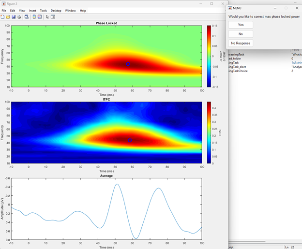
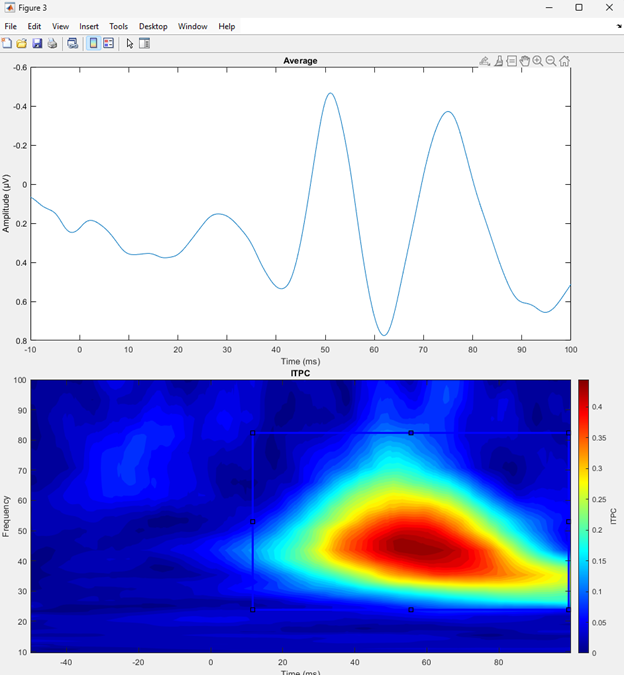
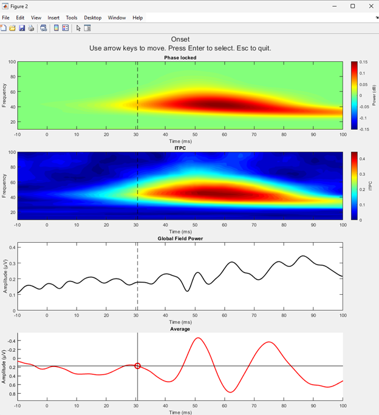

# EEG SEP Processing and Analysis Tool
## Purpose
This tool is designed for clinicians, researchers, and students to apply the proposed new data processing and analysis pipeline proposed by the researchers who made this code. It is a ready-to-use pipeline for raw EEG data, allowing for cleaning, transformation, and analysis through intuitive GUIs.\
This pipeline was validated in this study [link to paper]

## Key Features
### Batch Time-Frequency Processing, Global Field Processing, and Time Domain Processing

### Peak Detection and Extraction of Power Metrics for ITPC and PLP
- Automatic extraction of peaks from standard tests\
  
- The option to manually correct to a different range\
  

### Peak Amplitude Detection and Extraction of Time Domain Metrics
- Automatic extraction of peaks from standard tests 
- The option to manually correct to a different point\
 
- Automatically calculates peak-to-peak metrics

### Data Export
Extract and save processed data and extracted peak values 

## Requirements 
- MATLAB
- Toolboxes: EEGLAB, Signal Processing, Statistics and Machine Learning

## Getting Started
Example Data has been provided in the Data folder
### To process data
With the first pop-up, select process data
With the first pop-up, select the folder with raw data (labelled Raw Data)
The next pop-up, select the folder where you want the process data stored (labelled Processed Data)
Follow prompts to get patient/participant info
### To analyse data
With the first pop-up, select analyse data
Select the folder with the processed data (labelled Processed Data)
Follow the prompts to select peak powers and event locations

